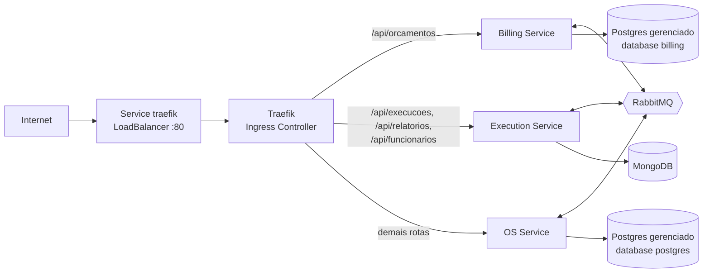

# oficina-infra-kubernetes

Infraestrutura como código (Terraform) do cluster Kubernetes (AKS) e tudo o
que os microsserviços compartilham dentro dele: API Gateway (Traefik),
mensageria (RabbitMQ), o banco NoSQL (MongoDB) e o monitoramento de recursos
do cluster (New Relic Infrastructure, via Helm).

Na Fase 4 o monólito foi separado em três microsserviços. Os repositórios do
projeto:

| Repositório | O que é |
|---|---|
| [fiat-tech-challenge-ddd](https://github.com/gilgledson/fiat-tech-challenge-ddd) | OS Service — ordens de serviço, clientes, veículos e estoque |
| [oficina-billing-service](https://github.com/gilgledson/oficina-billing-service) | Billing Service — orçamento e pagamento |
| [oficina-execution-service](https://github.com/gilgledson/oficina-execution-service) | Execution Service — diagnóstico e execução |
| [fiat-tech-challenge-infra-database](https://github.com/gilgledson/fiat-tech-challenge-infra-database) | Terraform do Postgres gerenciado (OS Service e Billing) |
| [fiat-tech-challenge-lambda-auth-cpf](https://github.com/gilgledson/fiat-tech-challenge-lambda-auth-cpf) | Function Serverless de autenticação por CPF |
| este | Cluster e infraestrutura compartilhada |

## Propósito

Este repositório é o **dono do Resource Group** Azure (`oficina-resources`)
e provisiona:

- O cluster **AKS** (`oficina-aks-cluster`) onde os três microsserviços rodam.
- O **API Gateway** (Traefik), como Ingress Controller do cluster —
  `k8s/gateway/`.
- O **RabbitMQ** da Saga, compartilhado pelos três serviços —
  `k8s/messaging/`.
- O **MongoDB** do Execution Service — `k8s/data/`.
- A integração de **monitoramento de infraestrutura** do New Relic
  (CPU/memória de nós e pods, eventos do cluster, forwarding de logs) via
  Helm chart — `k8s/observability/`.

Os repositórios de banco e da Function leem o Resource Group criado aqui via
`data source` (nunca o recriam) — este é o **primeiro repositório a ser
aplicado**.

O que **não** fica aqui: o Deployment, o Service, o HPA e o Ingress de cada
microsserviço. Cada serviço é dono dos próprios manifestos e os aplica pelo
próprio pipeline.

## Arquitetura



Na prática: Traefik, RabbitMQ e MongoDB são deste
repositório; os três serviços e seus Ingress vêm dos repositórios deles; o
Postgres vem do repositório de banco.

| Rota | Quem define o Ingress | Serviço |
|---|---|---|
| `/` | este repositório (`k8s/gateway/ingress.yaml`) | `oficina-api-service` (OS Service) |
| `/api/orcamentos` | `oficina-billing-service` | `oficina-billing-service` |
| `/api/execucoes`, `/api/relatorios`, `/api/funcionarios` | `oficina-execution-service` | `oficina-execution-service` |

O prefixo mais específico ganha da rota `/`, então os Ingress do Billing e do
Execution têm prioridade sobre o do OS Service.

### HTTPS

O gateway responde em `https://oficina-fiap.brazilsouth.cloudapp.azure.com`,
um nome gratuito da Azure ligado ao IP público pela anotação
`service.beta.kubernetes.io/azure-dns-label-name` do Service do Traefik.

O certificado é do Let's Encrypt, pedido e renovado pelo próprio Traefik
(desafio HTTP na porta 80) e guardado no volume `traefik-certificados`, para
não ser pedido de novo a cada reinício. O TLS fica no entrypoint `websecure`,
então vale para todos os Ingress sem mudar os manifestos dos serviços. A porta
80 continua respondendo.

O HTTPS é exigido pelo webhook do Mercado Pago, cadastrado na aplicação de
teste com o endereço
`https://oficina-fiap.brazilsouth.cloudapp.azure.com/api/orcamentos/webhooks/mercadopago`.

## Tecnologias

- Terraform (`provider "azurerm"`) — AKS, Resource Group
- [Traefik](https://traefik.io/) — API Gateway / Ingress Controller
- RabbitMQ 3.13 — mensageria da Saga
- MongoDB 7 — banco NoSQL do Execution Service
- Helm (`newrelic/nri-bundle`) — monitoramento de infraestrutura do cluster

## Como aplicar

### 1. Infraestrutura (Terraform)

```bash
cd infra
terraform init
terraform plan
terraform apply
```

Sem variáveis obrigatórias. Duas opcionais:

| Variável | Padrão | Para quê |
|---|---|---|
| `node_count` | `2` | Quantidade de nós. Com um nó de 2 vCPUs tudo cabe, mas sem folga para o HPA escalar |
| `node_vm_size` | `Standard_D2s_v3` | Tamanho da VM dos nós |

Para subir com um nó só, mais barato: `terraform apply -var node_count=1`.

### 2. Configurar `kubectl`

```bash
az aks get-credentials --resource-group oficina-resources --name oficina-aks-cluster
```

### 3. API Gateway (Traefik)

```bash
kubectl apply -f k8s/gateway/namespace.yaml
kubectl apply -f k8s/gateway/rbac.yaml
kubectl apply -f k8s/gateway/ingressclass.yaml
kubectl apply -f k8s/gateway/deployment.yaml
kubectl apply -f k8s/gateway/service.yaml
# k8s/gateway/ingress.yaml só depois que o OS Service tiver aplicado o
# Service dele (oficina-api-service):
kubectl apply -f k8s/gateway/ingress.yaml
```

### 4. Mensageria e banco NoSQL

As credenciais não ficam no repositório. Crie os dois Secrets uma vez,
escolhendo usuário e senha:

```bash
kubectl create secret generic rabbitmq-credentials \
  --from-literal=username=<usuario> --from-literal=password=<senha>
```

```bash
kubectl create secret generic mongodb-credentials \
  --from-literal=username=<usuario> --from-literal=password=<senha>
```

Depois aplique:

```bash
kubectl apply -f k8s/messaging/rabbitmq.yaml -f k8s/data/mongodb.yaml
```

Os mesmos valores vão como secrets do GitHub nos repositórios dos serviços:

| Secret no GitHub | Repositórios | Valor |
|---|---|---|
| `RABBITMQ_USERNAME`, `RABBITMQ_PASSWORD` | os três serviços | os do Secret `rabbitmq-credentials` |
| `EXECUTION_MONGODB_URL` | `oficina-execution-service` | `mongodb://<usuario>:<senha>@mongodb.default.svc.cluster.local:27017/?authSource=admin` |

Para abrir o painel do RabbitMQ: `kubectl port-forward svc/rabbitmq 15672:15672`.

### 5. Monitoramento de infraestrutura (Helm)

```bash
helm repo add newrelic https://helm-charts.newrelic.com
helm repo update
helm upgrade --install newrelic-bundle newrelic/nri-bundle \
  --namespace newrelic --create-namespace \
  --set global.licenseKey=<sua-license-key> \
  -f k8s/observability/newrelic-values.yaml
```

## Por que o `terraform apply` é manual (não roda em CI)

O `terraform plan` roda automaticamente em todo Pull Request (ver
[`.github/workflows/ci.yml`](.github/workflows/ci.yml)) como verificação —
mas o `apply` é deliberadamente manual. Provisionar/alterar um cluster
Kubernetes e sua VM subjacente automaticamente a cada merge é um risco
desproporcional (custo, drift de credenciais — já vivenciado durante o
desenvolvimento deste projeto) para um projeto deste porte. Os três
microsserviços têm deploy automático porque são código-fonte com testes;
infraestrutura de cluster é tratada com uma etapa manual de revisão antes do
`apply`, deliberadamente. O mesmo vale para o RabbitMQ e o MongoDB: são
aplicados uma vez, à mão, e não a cada merge.

## Custos

Os recursos aqui (AKS + a VM do node pool) ficam **ligados 24/7** e cobram
por tempo, independente de uso. Rode `terraform destroy` quando não estiver
trabalhando ativamente no projeto, para evitar cobrança desnecessária.
